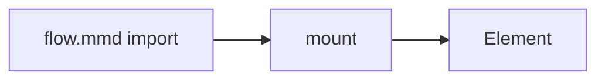

# mount

Insert a precompiled diagram into an element in place of its contents.

`mount` sets the markup of the element to the SVG of the diagram. Compiled output is trusted, inert SVG, so `mount` does not parse Mermaid or sanitize the markup. The [Mounting](/docs/guides/mounting) guide shows common tasks.

```ts title="main.ts"
import { mount } from 'ondine'
import flow from './flow.mmd'

// Replaces the element's contents with the diagram
const mounted = mount(document.getElementById('flow')!, flow)
```



## Signature

```ts
// Returns a handle that removes the diagram
mount(element, diagram)
```

## Parameters

### element

- **Type:** `Element{:ts}`

The element to fill. `mount` replaces the existing children of this element.

```ts
import { mount } from 'ondine'
import flow from './flow.mmd'

// Fills the first figure on the page
mount(document.querySelector('figure')!, flow)
```

### diagram

- **Type:** `string | { readonly svg: string }{:ts}`

The precompiled SVG, or an object that contains it, such as a Vite import or a `render` result.

```ts
import { mount } from 'ondine'

// Mounts SVG fetched from a CLI build
const svg = await fetch('/diagrams/flow.svg').then((response) => response.text())
mount(document.getElementById('flow')!, svg)
```

Pass only SVG that Ondine compiled. `mount` inserts the string as markup without changes.

## Returns

### unmount

- **Type:** `() => void{:ts}`

Removes the diagram from the element. After this call, the element has no children.

```ts
import { mount } from 'ondine'
import flow from './flow.mmd'

const mounted = mount(document.getElementById('flow')!, flow)

// Empties the element
mounted.unmount()
```
