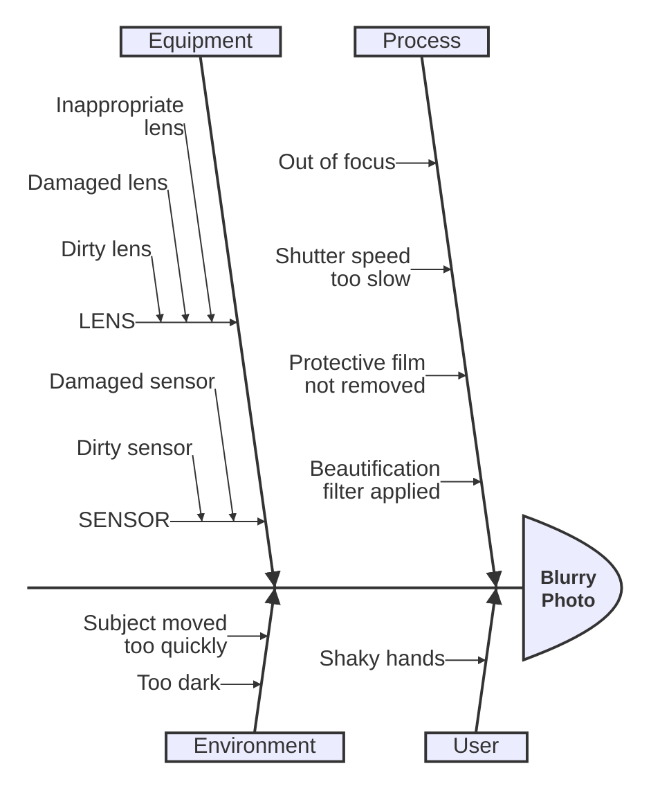

{/* Generated by scripts/generate.ts. Do not edit. */}

# Ishikawa

Causes branching from a spine toward an effect. Mermaid marks this type as beta.

## Examples

The playground samples for this type, rendered by Ondine when the documentation builds.

### Example 1

