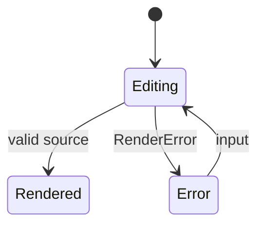

# In-Browser Compilation

Compile Mermaid in the browser or an edge runtime when the source is only known at runtime.

## Overview

Most pages compile diagrams at build time. Editors, previews, and diagrams from users need the compiler at runtime. `ondine/compiler/wasm` supplies this compiler, and the caller supplies the WebAssembly module.

```ts title="preview.ts"
import { create } from 'ondine/compiler/wasm'
import url from 'ondine/compiler/wasm/all.wasm?url'

// Compiles the size-optimized module while it downloads
const all = await WebAssembly.compileStreaming(fetch(url))
const renderer = create({ modules: { all } })
const { svg } = renderer.render('flowchart LR\n  A --> B')
```

The JavaScript glue in `ondine/compiler/wasm` is about 1 kB gzip. The `all.wasm` module holds every diagram type, at about 630 kB gzip.

## Walkthrough

The steps below make a live preview. The preview renders the diagram again after each change to the source.

### Load the Module

Fetch `all.wasm` and compile it with `WebAssembly.compileStreaming`. The browser compiles the module while it downloads, and it caches the compiled code. The server must send `application/wasm`.

<Tabs>
<Tab title="Vite">

```ts title="preview.ts"
import { create } from 'ondine/compiler/wasm'
import url from 'ondine/compiler/wasm/all.wasm?url'

// Emits all.wasm as an asset and compiles it on first use
const all = await WebAssembly.compileStreaming(fetch(url))
const renderer = create({ modules: { all } })
```

</Tab>
<Tab title="Static File">

```ts title="preview.ts"
import { create } from 'ondine/compiler/wasm'

// Serves node_modules/ondine/dist/internal/all.generated.wasm at /ondine/all.wasm
const all = await WebAssembly.compileStreaming(fetch('/ondine/all.wasm'))
const renderer = create({ modules: { all } })
```

</Tab>
</Tabs>

### Render on Input

Each `render` call compiles synchronously. A renderer keeps its module instance. Create the renderer once and use it for each input event.

```ts title="preview.ts"
import { RenderError } from 'ondine/compiler/wasm'

const input = document.querySelector('textarea')!
const output = document.getElementById('preview')!

input.addEventListener('input', () => {
  try {
    // Replaces the preview with the new diagram
    output.innerHTML = renderer.render(input.value, { maxWidth: output.clientWidth }).svg
  } catch (error) {
    if (!(error instanceof RenderError)) throw error
    output.textContent = error.message
  }
})
```

### Show Errors

`RenderError` has the line, the column, and a snippet with a caret. These values match the diagnostics of Mermaid.



## Recipes

### Cloudflare Workers

Cloudflare Workers reject WebAssembly compilation at runtime. Import a `.wasm` file so that the bundler compiles the module ahead of time. Then pass the `WebAssembly.Module` to `create`.

```ts title="worker.ts"
import { create } from 'ondine/compiler/wasm'
import all from 'ondine/compiler/wasm/all.wasm'

// Uses the precompiled module, so no compilation occurs at runtime
const renderer = create({ modules: { all } })
```

### Load One Type

If a page compiles only one diagram type, load the module for that type, such as `flowchart.wasm`. This module is much smaller than `all.wasm`. [Diagram Modules](/docs/api/compiler-wasm/types) lists every type.

```ts title="preview.ts"
import { create } from 'ondine/compiler/wasm'
import url from 'ondine/compiler/wasm/flowchart.wasm?url'

// Renders flowcharts and throws RenderError for other types
const flowchart = await WebAssembly.compileStreaming(fetch(url))
const renderer = create({ modules: { flowchart } })
```

### Inline the Module

The `ondine/compiler/wasm/all` entrypoint inlines `all.wasm` as base64, at about 830 kB gzip. It needs no file server, but the page downloads more, and `create` compiles the bytes only after the whole module loads.

```ts title="preview.ts"
import { create } from 'ondine/compiler/wasm'

// Splits the base64 module into its own chunk
const { wasm } = await import('ondine/compiler/wasm/all')
const renderer = create({ modules: { all: wasm } })
```

### Offload Compilation

A large diagram can take milliseconds to compile. Move the renderer into a Web Worker. Then post the SVG back to the page.

```ts title="compile.worker.ts"
import { create } from 'ondine/compiler/wasm'
import url from 'ondine/compiler/wasm/all.wasm?url'

// Starts compiling at once, so that early messages wait for the renderer
const renderer = WebAssembly.compileStreaming(fetch(url)).then((all) =>
  create({ modules: { all } }),
)

// Responds to each message with the compiled SVG
self.onmessage = async (event: MessageEvent<string>) => {
  self.postMessage((await renderer).render(event.data).svg)
}
```

## More

<Cards>
  <Card
    title="ondine/compiler/wasm"
    icon="cpu"
    to="/docs/api/compiler-wasm"
    description="Reference for the in-browser entrypoints."
  />
  <Card
    title="create"
    icon="code"
    to="/docs/api/compiler/create"
    description="Make a renderer from specific modules."
  />
  <Card
    title="Benchmarks"
    icon="gauge"
    to="/docs/introduction/benchmarks"
    description="Module sizes for each diagram type."
  />
</Cards>
