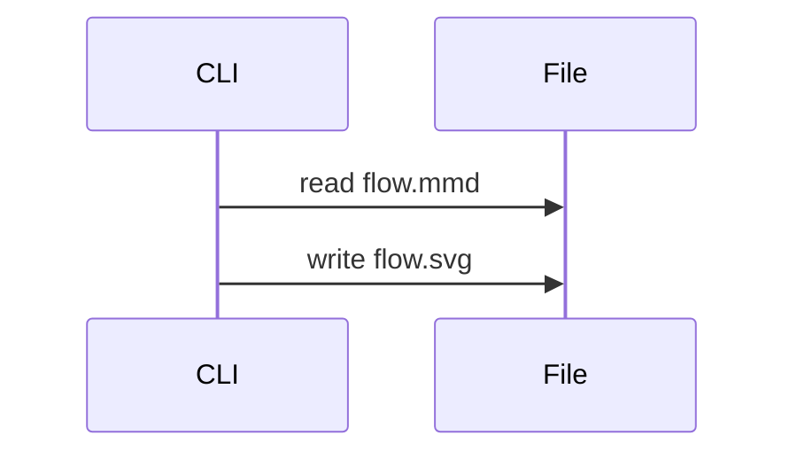

# CLI

Render Mermaid files to SVG files from a terminal or a build script.

## Overview

The `ondine` command compiles each `.mmd` or `.mermaid` file in its arguments. It writes an `.svg` file with the same base name. If the arguments name no files, the command reads Mermaid from standard input and writes SVG to standard output.

```sh
# Writes docs/flow.svg
npx ondine docs/flow.mmd
```

The command uses the same compiler as `ondine/compiler`, so its output matches `render` with default options byte for byte. The Vite plugin uses this compiler too, but adds an ID prefix for each file.

## Walkthrough

The steps below render a directory of diagrams into a directory of static assets.

### Write Diagrams

Save each diagram in a `.mmd` file. The command reads each source file and writes one SVG file for it.



### Render the Directory

`--out-dir` (or `-o`) writes every SVG file into one directory. If the directory does not exist, the command creates it.

```sh
# Writes public/diagrams/<name>.svg for each source file
npx ondine diagrams/*.mmd --out-dir public/diagrams
```

The command reports each file that it writes on standard error as `source -> output`.

### Reference the Output

Use each SVG file as an image, or put its markup inline in the HTML.

```html title="index.html"
<!-- Loads the compiled diagram as an image -->

```

An image cannot read the styles of the page, so it keeps the default black-on-white theme. To [theme](/docs/guides/theming) the diagram with CSS, put the SVG markup inline.

## Recipes

### Pipe Source

Without file arguments, the command renders standard input to standard output.

```sh
# Renders standard input to standard output
cat flow.mmd | npx ondine > flow.svg
```

### Fail on Errors

The command reports each invalid diagram as `file:line:column: message`. It renders the remaining files and then exits with code 1.

```sh
# Stops a build when any diagram fails
npx ondine diagrams/*.mmd -o public/diagrams || exit 1
```

### Render Markdown

The command rewrites each ` ```mermaid ` fence in a `.md` or `.markdown` file in place. Each fence becomes a `<picture>` with light and dark images. By default, the images link to the [image Worker](/docs/guides/github), for READMEs on GitHub.

```sh
# Rewrites the fences in README.md to Worker images
npx ondine README.md
```

The `<picture>` is in a block between `<!-- ondine:<payload> -->` and `<!-- /ondine -->`. The payload is the encoded source. A later run renders the block again and does not add a second block. If the output does not change, the command does not write the file.

### Link SVG Files

`--svg` writes `<name>-<n>.light.svg` and `<name>-<n>.dark.svg` beside the Markdown file, or in `--out-dir`. The blocks link to these files. The command removes SVG files that a previous run wrote and that no block links to now.

```sh
# Writes docs/assets/guide-1.light.svg and docs/assets/guide-1.dark.svg
npx ondine docs/guide.md --svg --out-dir docs/assets
```

### Edit a Diagram

`--restore` changes each block back into its ` ```mermaid ` fence and removes the SVG files of the block. Edit the fence. Then render the file again.

```sh
# Restores the fences, then renders them again after editing
npx ondine README.md --restore
npx ondine README.md
```

### Check in CI

`--check` writes no files. If a file is out of date, the command names the file and exits with code 1.

```sh
# Fails when README.md has unrendered fences
npx ondine README.md --check
```

### Add a Script

A `package.json` script renders the directory with one command.

```json title="package.json"
{
  "scripts": {
    "diagrams": "ondine diagrams/*.mmd --out-dir public/diagrams"
  }
}
```

## More

<Cards>
  <Card
    title="CLI Reference"
    icon="terminal"
    to="/docs/api/cli"
    description="Arguments, options, output, and exit codes."
  />
  <Card
    title="Node Compiler"
    icon="code"
    to="/docs/guides/node"
    description="Render diagrams from scripts with options."
  />
  <Card
    title="Theming"
    icon="palette"
    to="/docs/guides/theming"
    description="Style compiled SVG with CSS custom properties."
  />
</Cards>
