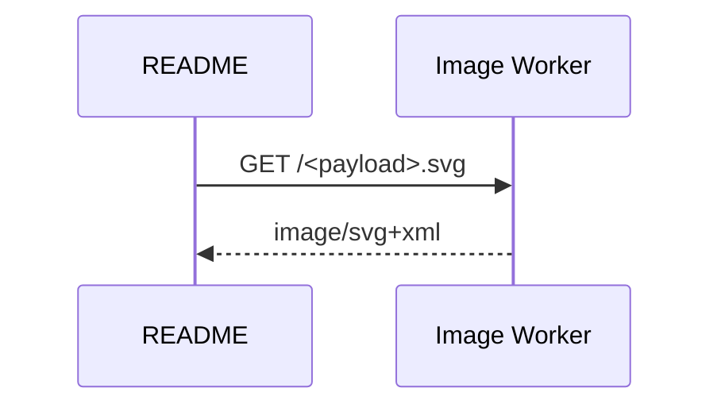

# GitHub Images

Embed Ondine diagrams in READMEs and other Markdown that cannot run scripts or load styles.

## Overview

GitHub draws ` ```mermaid ` fences with its own renderer. To show a Ondine diagram, a README links an image from the image Worker, which compiles the diagram encoded in the URL on request.



## Walkthrough

The steps below encode a diagram and embed it with light and dark variants.

### Encode the Source

The payload is the source as UTF-8, compressed with zlib deflate, then encoded as base64url. This is the encoding Kroki uses.

```ts title="encode.ts"
import * as Zlib from 'node:zlib'

// Produces the path segment for one diagram
const payload = Zlib.deflateSync('flowchart LR\n  A --> B').toString('base64url')
```

Markdown written by hand or by an agent can skip compression. The `/svg` path reads the source percent-encoded in its `source` query parameter.

```md title="README.md"
<!-- Encodes the same diagram with encodeURIComponent -->


```

### Embed the Image

Without a `scheme` parameter, one image follows the viewer's color scheme through `prefers-color-scheme`.

```md title="README.md"
<!-- Follows the reader's color scheme -->


```

### Pin Each Scheme

GitHub draws images inside a page whose scheme may differ from the system's. A `<picture>` with pinned variants follows the scheme GitHub chose.

```html title="README.md"
<!-- Chooses the variant that matches GitHub's theme -->
<picture>
  <source
    media="(prefers-color-scheme: dark)"
    srcset="https://ondine.sh/<payload>.svg?scheme=dark"
  />
  .svg?scheme=light" />
</picture>
```

## Recipes

### Rewrite a README

The [CLI](/docs/guides/cli#render-markdown) rewrites every ` ```mermaid ` fence in a Markdown file to the `<picture>` above, keeping the source in the block so later runs re-render it.

```sh
# Rewrites the fences in README.md, then fails CI when it goes stale
npx ondine README.md
npx ondine README.md --check
```

`--worker` links another deployment, and `--svg` commits SVG files instead of linking the Worker.

### Read Errors

Invalid source returns status 400 with an SVG card that states the error, so a broken diagram explains itself in the README.

### Stay Under Limits

Paths over 4,096 characters and sources over 64 KiB after inflating are rejected. GitHub's image proxy rejects URLs over about 8 kB, so long diagrams may need splitting.

### Deploy a Worker

The image Worker is part of the documentation site in `site/` and answers at `https://ondine.sh`.

```sh
# Builds the site with the image route and deploys it with Wrangler
pnpm --dir site run deploy
```

## More

<Cards>
  <Card
    title="Image Worker"
    icon="image"
    to="/docs/api/worker"
    description="Request format, responses, headers, and limits."
  />
  <Card
    title="Theming"
    icon="palette"
    to="/docs/guides/theming"
    description="See the properties each scheme sets."
  />
  <Card
    title="CLI"
    icon="terminal"
    to="/docs/guides/cli"
    description="Commit rendered SVG files instead."
  />
</Cards>
