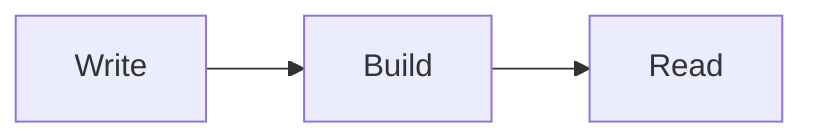

# MDX

Compile Mermaid fences in MDX and Markdown to inline SVG during the build.

## Overview

The `remarkOndine` plugin from `ondine/remark` replaces each ` ```mermaid ` fence with the SVG that Ondine compiles from it. The page bundle holds SVG markup and no compiler.

The plugin works with `@mdx-js/mdx` in its MDX and Markdown formats, with `remark-rehype`, and with each framework that MDX targets.


## Walkthrough

The steps below add the plugin, write a diagram, and style it on the page.

### Add the Plugin

Add `remarkOndine` to the `remarkPlugins` of the MDX compiler.

<Tabs>
<Tab title="Vite">

```ts title="vite.config.ts"
import mdx from '@mdx-js/rollup'
import { remarkOndine } from 'ondine/remark'
import { defineConfig } from 'vite'

// Compiles Mermaid fences in .mdx and .md imports to SVG
export default defineConfig({
  plugins: [mdx({ remarkPlugins: [remarkOndine] })],
})
```

</Tab>
<Tab title="Node">

````ts title="compile.ts"
import { compile } from '@mdx-js/mdx'
import { remarkOndine } from 'ondine/remark'

// Compiles one MDX document to JavaScript with its diagrams as SVG
const code = await compile('```mermaid\nflowchart LR\n  A --> B\n```', {
  remarkPlugins: [remarkOndine],
})
````

</Tab>
</Tabs>

### Write a Diagram

Write a ` ```mermaid ` fence in the page. Fences in other languages stay as code blocks.

````mdx title="page.mdx"
{/* Compiles to an inline SVG at build time */}


````


### Style the Diagram

Each diagram is a `<div class="ondine-diagram">` around the `<svg>`. The `data-ondine-diagram` attribute holds the diagram type. Set the `--ondine-*` custom properties on the wrapper to change colors without a rebuild.

```css title="page.css"
/* Draws diagrams in the page's text color */
.ondine-diagram {
  --ondine-fg: currentColor;
  --ondine-line: currentColor;
}
```

## Recipes

### Set Render Options

The plugin takes the options of [`render`](/docs/api/compiler/render), except `idPrefix`. The options apply to each diagram in a file.

```ts title="vite.config.ts"
import mdx from '@mdx-js/rollup'
import { remarkOndine } from 'ondine/remark'
import { defineConfig } from 'vite'

// Lays out each diagram for a 640-pixel column
export default defineConfig({
  plugins: [mdx({ remarkPlugins: [[remarkOndine, { maxWidth: 640 }]] })],
})
```

### Read Errors

If a fence holds invalid Mermaid, the build fails. The error starts with the file, then the line and column in the document.

````mdx title="page.mdx"
{/* The arrow on line 7 has no target */}

# Broken

```mermaid
flowchart LR
  A -->
```
````

```txt
page.mdx:8:1: Parse error on line 3:

^
Expecting 'NODE_STRING', got 'EOF'
```

### Write Markdown Back

If the same processor serializes the tree to Markdown, each diagram becomes its ` ```mermaid ` fence again. A page can then publish its Markdown source for agents, such as in an `llms.txt` file.

### Use Several Diagrams

Each diagram gets an element-ID prefix from its file path and its position in the file. Several diagrams on one page do not share IDs.

## More

<Cards>
  <Card
    title="ondine/remark"
    icon="file-code"
    to="/docs/api/remark/remarkOndine"
    description="Reference for the plugin and its options."
  />
  <Card
    title="Theming"
    icon="palette"
    to="/docs/guides/theming"
    description="Set colors, fonts, and strokes with CSS custom properties."
  />
  <Card
    title="Vite"
    icon="file-code"
    to="/docs/guides/vite"
    description="Import Mermaid files as SVG compiled during the build."
  />
</Cards>
