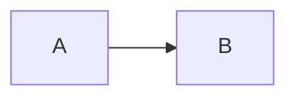

# Node Compiler

Render Mermaid to SVG from build scripts, servers, and static site generators.

## Overview

`render` from `ondine/compiler` compiles Mermaid source. It returns the SVG document, its size, and the detected diagram type. The first call loads the speed-optimized compiler module, and later calls use the same module.

```ts title="build.ts"
import { render } from 'ondine/compiler'

// Compiles synchronously, without a browser or a DOM
const { height, svg, type, width } = render('flowchart LR\n  A --> B')
```



## Walkthrough

The steps below render the diagrams of a Markdown site during the site build.

### Render Source

Pass the text of a ` ```mermaid ` fence or a `.mmd` file to `render`.

```ts title="build.ts"
import * as Fs from 'node:fs'
import { render } from 'ondine/compiler'

// Writes the compiled SVG beside its source
const source = Fs.readFileSync('flow.mmd', 'utf8')
Fs.writeFileSync('flow.svg', render(source).svg)
```

### Handle Errors

If the source is invalid, `render` throws a `RenderError`. The error has a code, a one-based line and column, and a snippet with a caret under the column.

```ts title="build.ts"
import { render, RenderError } from 'ondine/compiler'

try {
  render('flowchart LR\n  A -->')
} catch (error) {
  // Rethrows anything that is not a diagram error
  if (!(error instanceof RenderError)) throw error
  console.error(`flow.mmd:${error.line}:${error.column}: ${error.message}`)
}
```

### Insert the SVG

The compiled SVG is inert, so a template can insert it as raw HTML. Several diagrams can share a page. Give each diagram its own `idPrefix` to keep the IDs unique.

```ts title="build.ts"
import { render } from 'ondine/compiler'

// Wraps the diagram in a figure for an HTML template
const html = `<figure>${render('pie\n  "A" : 1\n  "B" : 2').svg}</figure>`
```

## Recipes

### Fit a Column

`maxWidth` sets the width available to the diagram. If a diagram that runs across does not fit, the compiler draws it running down. The `autoDirection` option controls this behavior.

```ts
import { render } from 'ondine/compiler'

// Draws a long left-to-right chain from top to bottom
render('flowchart LR\n  A --> B --> C --> D --> E --> F', { maxWidth: 320 })
```

### Collect Links

`render` returns the URLs of `click` directives in `links`, in drawing order. Tools can use this list to check or rewrite the URLs.

```ts
import { render } from 'ondine/compiler'

// [{ href: 'https://example.com/', id: 'A', internal: false }]
const { links } = render('flowchart LR\n  A --> B\n  click A "https://example.com"')
```

### Bound the Work

Options limit the source length, the number of edges, and the SVG length of untrusted source. If the input exceeds a limit, `render` throws a `RenderError` with code `limit`.

```ts
import { render } from 'ondine/compiler'

export function handle(source: string) {
  // Rejects source over 10,000 characters and SVG over 1,000,000 characters
  return render(source, { limit: 10_000, outputLimit: 1_000_000 }).svg
}
```

### Create a Renderer

`create` makes a renderer from specific compiler modules. [In-Browser Compilation](/docs/guides/browser) shows how to use it. Node code seldom needs `create`.

## More

<Cards>
  <Card
    title="render"
    icon="code"
    to="/docs/api/compiler/render"
    description="Every option and returned field."
  />
  <Card
    title="RenderError"
    icon="triangle-alert"
    to="/docs/api/compiler/RenderError"
    description="Error codes, positions, and messages."
  />
  <Card
    title="CLI"
    icon="terminal"
    to="/docs/guides/cli"
    description="Render files without writing a script."
  />
</Cards>
