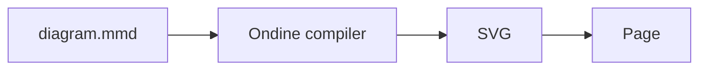

# Getting Started

Compile Mermaid diagrams to SVG ahead of time and mount them with a 210-byte runtime.

## Overview

Ondine renders Mermaid source to SVG. A Rust compiler parses, lays out, and draws each diagram at build time. Pages then ship SVG markup and no diagram renderer.



The compiler runs in these integrations:

- **Vite:** The Vite plugin compiles diagram imports.
- **CLI:** The `ondine` CLI writes SVG files.
- **Node:** The Node API returns SVG to scripts and servers.
- **Worker:** An image Worker serves SVG to Markdown hosts.
- **Browser:** If a page must compile at runtime, a WebAssembly module compiles in the browser.

## Install

Install Ondine with the project's package manager.

<Tabs>
<Tab title="pnpm">

```sh
# Adds Ondine to the project
pnpm add ondine
```

</Tab>
<Tab title="npm">

```sh
# Adds Ondine to the project
npm install ondine
```

</Tab>
<Tab title="yarn">

```sh
# Adds Ondine to the project
yarn add ondine
```

</Tab>
</Tabs>

## Setup

Select the integration that matches the build. Each integration runs the same compiler and emits the same bytes.

<Tabs>
<Tab title="Vite">

Add the plugin to `vite.config.ts`. The plugin then compiles imports of `.mmd` and `.mermaid` files at build time.

```ts title="vite.config.ts"
import { defineConfig } from 'vite'
import { ondine } from 'ondine/vite'

export default defineConfig({
  // Compiles .mmd and .mermaid imports to SVG
  plugins: [ondine()],
})
```

Import a diagram, then mount it. The default export contains the SVG, its size, and the detected diagram type.

```ts title="main.ts"
import { mount } from 'ondine'
import flow from './flow.mmd'

// Inserts the precompiled SVG into the element
mount(document.getElementById('flow')!, flow)
```

</Tab>
<Tab title="CLI">

The CLI renders each Mermaid file to an SVG file beside it, or into a different directory.

```sh
# Writes flow.svg next to flow.mmd
npx ondine flow.mmd

# Writes every diagram into public/diagrams
npx ondine diagrams/*.mmd --out-dir public/diagrams
```

If no files are given, the CLI reads standard input and writes SVG to standard output.

```sh
# Pipes Mermaid in and SVG out
echo 'flowchart LR; A --> B' | npx ondine > flow.svg
```

</Tab>
<Tab title="Node">

Call `render` from a build script, a server, or a static site generator.

```ts title="build.ts"
import { render } from 'ondine/compiler'

// Returns the SVG document with its size and diagram type
const { svg } = render('flowchart LR\n  A --> B')
```

The compiler module loads on the first call. Later calls use the same module.

</Tab>
</Tabs>

## Next Steps

<Cards>
  <Card
    title="Vite"
    icon="zap"
    to="/docs/guides/vite"
    description="Import Mermaid files as precompiled SVG."
  />
  <Card
    title="Theming"
    icon="palette"
    to="/docs/guides/theming"
    description="Set colors, fonts, and strokes with CSS custom properties."
  />
  <Card
    title="Diagrams"
    icon="shapes"
    to="/docs/diagrams/flowchart"
    description="Browse every diagram type with rendered examples."
  />
</Cards>
