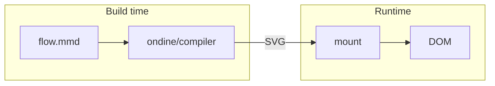

# Why Ondine

Ondine compiles Mermaid source ahead of time into SVG that pages display without a renderer.

## Overview

A Mermaid diagram usually renders in the browser. The page downloads a parser and a layout engine, measures text with the DOM, and draws the diagram after the page loads. Ondine does all of this work at build time.

## Build-Time Compilation

The Vite plugin, the CLI, a Node script, or the image Worker compiles each diagram. A syntax error stops the build and reports its line and column. Thus, a broken diagram never reaches a page.

The compiler reads no files, no clock, and no environment. The same source and options produce the same bytes in Node, in browsers, and in Workers.

## Fast Mounts

The page receives finished SVG, so a mount only inserts markup. The browser does no parsing, layout, or text measurement. Diagrams appear at the same time as the rest of the page.

## Small Bundles

Pages ship the SVG and the `ondine` runtime that mounts it. The runtime is 210 bytes gzip. The parser, the layout engine, and the renderer stay in the build.

## Mermaid Syntax

Ondine targets the complete syntax of Mermaid 12.1.0. Each diagram type accepts and rejects the same input as Mermaid and builds the same model. Layout and appearance are different by design.

## More

<Cards>
  <Card
    title="Getting Started"
    icon="rocket"
    to="/docs/introduction/getting-started"
    description="Install Ondine and compile a first diagram."
  />
  <Card
    title="Benchmarks"
    icon="gauge"
    to="/docs/introduction/benchmarks"
    description="Review measured module sizes and render times."
  />
  <Card
    title="Theming"
    icon="palette"
    to="/docs/guides/theming"
    description="Set colors, fonts, and strokes with CSS custom properties."
  />
</Cards>
