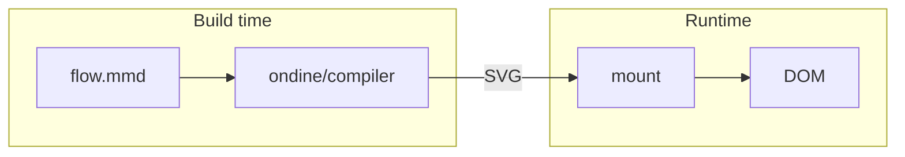

# Why Ondine

Mermaid source, compiled ahead of time into SVG that pages display without a renderer.

## Overview

A Mermaid diagram usually renders in the browser: the page downloads a parser and layout engine, measures text with the DOM, and draws after the page loads. Ondine moves all of that to build time.

## Compiled Ahead of Time

Diagrams compile in the Vite plugin, the CLI, a Node script, or the image Worker. A syntax error fails the build with its line and column, so a broken diagram never reaches a page.

The compiler reads no files, clock, or environment. The same source and options produce the same bytes in Node, browsers, and Workers.

## Fast Mounts

The page receives finished SVG, so displaying a diagram only inserts markup. No parsing, layout, or text measurement runs in the browser, and diagrams appear with the rest of the page.

## Small Bundles

Pages ship the SVG and the `ondine` runtime that mounts it, 210 bytes gzip. The parser, layout engine, and renderer stay in the build.

## Mermaid Syntax

Ondine targets the complete syntax of Mermaid 12.1.0. Each diagram type accepts and rejects the same input as Mermaid and builds the same model. Layout and appearance differ by design.

## More

<Cards>
  <Card
    title="Getting Started"
    icon="rocket"
    to="/docs/introduction/getting-started"
    description="Install Ondine and compile a first diagram."
  />
  <Card
    title="Benchmarks"
    icon="gauge"
    to="/docs/introduction/benchmarks"
    description="Review measured module sizes and render times."
  />
  <Card
    title="Theming"
    icon="palette"
    to="/docs/guides/theming"
    description="Set colors, fonts, and strokes with CSS custom properties."
  />
</Cards>
