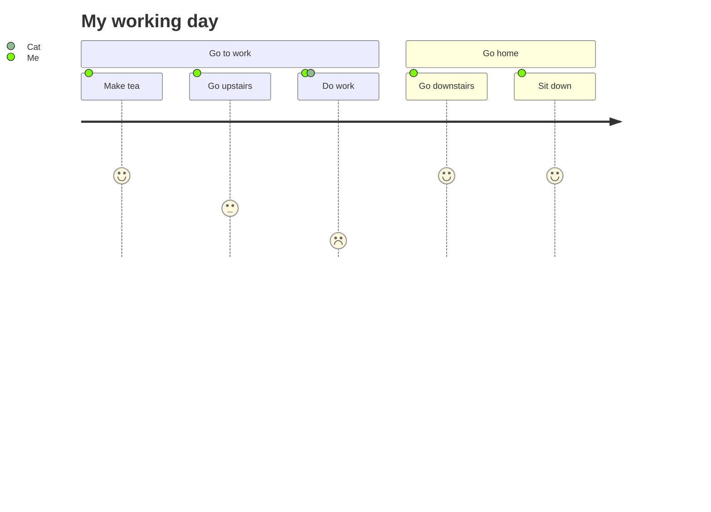

{/* Generated by scripts/generate.ts. Do not edit. */}

# User Journey

Tasks in sections, scored for each actor taking part.

## Status

- **Keyword:** `journey`
- **Status:** Matches Pele
- **Vectors:** 1 of 1 match Pele

The [Compatibility](/introduction/compatibility) page defines each status.

## Examples

The playground samples for this type, rendered by Ondine when the documentation builds.

### Example 1

