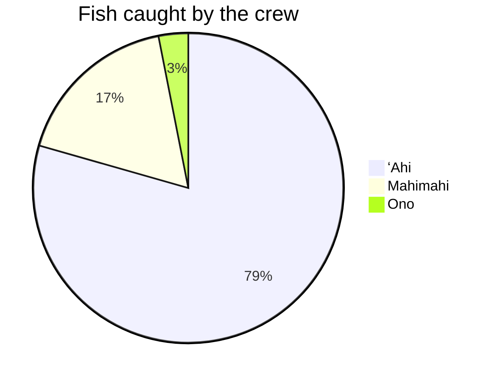
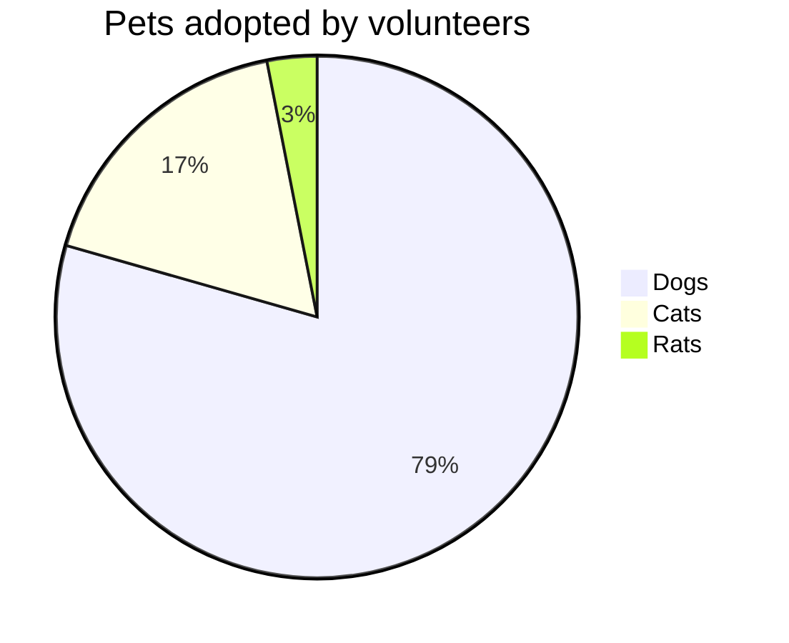
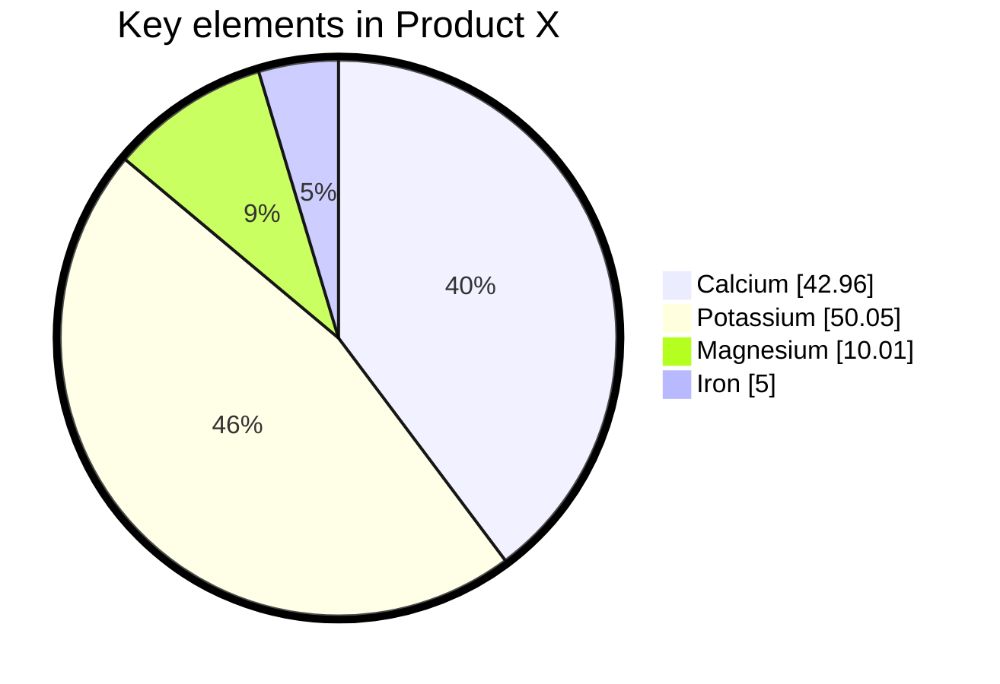

{/* Generated by scripts/generate.ts. Do not edit. */}

# Pie Chart

Slices sized by value, with an optional title.

## Status

- **Keyword:** `pie`
- **Status:** Matches Pele
- **Vectors:** 3 of 3 match Pele

The [Compatibility](/introduction/compatibility) page defines each status.

## Examples

The playground samples for this type, rendered by Melee when the documentation builds.

### Example 1

### Example 2

### Example 3

