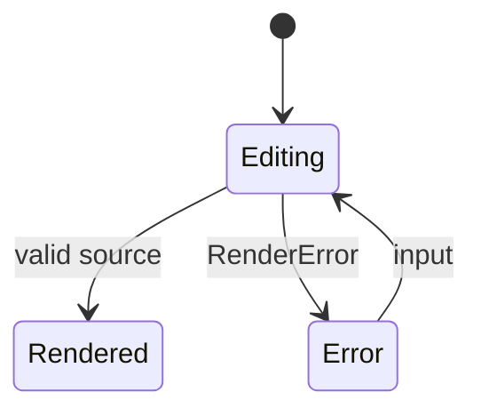

import { Card, Cards } from 'vocs'

# In-Browser Compilation

Compile Mermaid in the browser or an edge runtime when the source is only known at runtime.

## Overview

Most pages compile diagrams at build time. Editors, previews, and user-supplied diagrams need the compiler at runtime instead. `ondine/compiler/wasm` provides it, with the WebAssembly module supplied by the caller.

```ts title="preview.ts"
import { create } from 'ondine/compiler/wasm'
import { wasm as all } from 'ondine/compiler/wasm/all'

// Compiles in the browser with the size-optimized module
const renderer = create({ modules: { all } })
const { svg } = renderer.render('flowchart LR\n  A --> B')
```

The glue in `ondine/compiler/wasm` is about 1 kB gzip. `ondine/compiler/wasm/all` inlines every diagram type as base64, about 715 kB gzip, as [Benchmarks](/introduction/benchmarks) records.

## Walkthrough

The steps below build a live preview that redraws as source changes.

### Load the Module

Import `ondine/compiler/wasm/all` with a dynamic import, so the module downloads only when the preview opens.

```ts title="preview.ts"
import { create } from 'ondine/compiler/wasm'

// Splits the compiler module into its own chunk
const { wasm } = await import('ondine/compiler/wasm/all')
const renderer = create({ modules: { all: wasm } })
```

### Render on Input

Each call compiles synchronously. A renderer keeps its module instance, so create it once.

```ts title="preview.ts"
import { RenderError } from 'ondine/compiler/wasm'

const input = document.querySelector('textarea')!
const output = document.getElementById('preview')!

input.addEventListener('input', () => {
  try {
    // Replaces the preview with the new diagram
    output.innerHTML = renderer.render(input.value, { maxWidth: output.clientWidth }).svg
  } catch (error) {
    if (!(error instanceof RenderError)) throw error
    output.textContent = error.message
  }
})
```

### Show Errors

`RenderError` carries the line, column, and a snippet with a caret, matching Mermaid's diagnostics.



## Recipes

### Run in a Worker

Cloudflare Workers refuse to compile WebAssembly at runtime. Import a `.wasm` file so the bundler compiles it ahead of time, then pass the `WebAssembly.Module`.

```ts title="worker.ts"
import { create } from 'ondine/compiler/wasm'
import all from 'ondine/compiler/wasm/all.wasm'

// The module arrives precompiled, so no runtime compilation happens
const renderer = create({ modules: { all } })
```

### Load One Type

A page that compiles only one diagram type imports that type's module from `ondine/compiler/wasm/<type>`, which is much smaller than `all`. [Diagram Modules](/api/compiler-wasm/types) lists every type.

```ts title="preview.ts"
import { create } from 'ondine/compiler/wasm'
import { wasm as flowchart } from 'ondine/compiler/wasm/flowchart'

// Renders flowcharts and throws RenderError for other types
const renderer = create({ modules: { flowchart } })
```

### Compile Off the Main Thread

Large diagrams can take milliseconds. Move the renderer into a Web Worker and post SVG back to the page.

```ts title="compile.worker.ts"
import { create } from 'ondine/compiler/wasm'
import { wasm as all } from 'ondine/compiler/wasm/all'

const renderer = create({ modules: { all } })

// Answers each message with the compiled SVG
self.onmessage = (event: MessageEvent<string>) => {
  self.postMessage(renderer.render(event.data).svg)
}
```

## More

<Cards>
  <Card
    title="ondine/compiler/wasm"
    icon="cpu"
    to="/api/compiler-wasm"
    description="Reference for the in-browser entrypoints."
  />
  <Card
    title="create"
    icon="code"
    to="/api/compiler/create"
    description="Build a renderer over specific modules."
  />
  <Card
    title="Benchmarks"
    icon="gauge"
    to="/introduction/benchmarks"
    description="Module sizes for each diagram type."
  />
</Cards>
