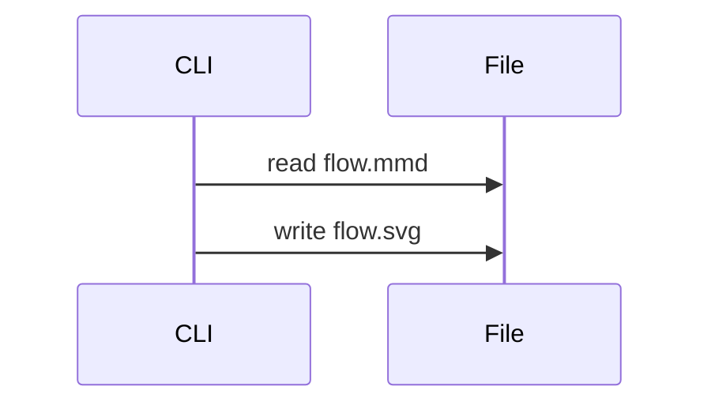

import { Card, Cards } from 'vocs'

# CLI

Render Mermaid files to SVG files from a terminal or a build script.

## Overview

The `melee` command compiles each `.mmd` or `.mermaid` file it receives and writes an `.svg` file with the same base name. With no files, it reads Mermaid from standard input and writes SVG to standard output.

```sh
# Writes docs/flow.svg
npx melee docs/flow.mmd
```

The command runs the same compiler as `melee/compiler`, so its output matches the Vite plugin and the Node API byte for byte.

## Walkthrough

The steps below render a folder of diagrams into a static assets folder.

### Write Diagrams



### Render the Folder

`--out-dir` (or `-o`) writes every SVG into one directory, creating it when missing.

```sh
# Writes public/diagrams/<name>.svg for each source file
npx melee diagrams/*.mmd --out-dir public/diagrams
```

Each rendered file is reported on standard error as `source -> output`.

### Reference the Output

Use the files as images, or inline them in HTML.

```html title="index.html"
<!-- Loads the compiled diagram as an image -->

```

An image cannot read page styles, so it keeps the default black-on-white theme. Inline the SVG markup to [theme](/guides/theming) it with CSS.

## Recipes

### Pipe Source

```sh
# Renders standard input to standard output
cat flow.mmd | npx melee > flow.svg
```

### Fail on Errors

An invalid diagram is reported as `file:line:column: message`, and the command exits with code 1 after rendering the remaining files.

```sh
# Stops a build when any diagram fails
npx melee diagrams/*.mmd -o public/diagrams || exit 1
```

### Render Markdown

Each ` ```mermaid ` fence in a `.md` or `.markdown` file is rewritten in place to a `<picture>` with light and dark images. By default the images link the [image Worker](/guides/github), which suits READMEs on GitHub.

```sh
# Rewrites the fences in README.md to Worker images
npx melee README.md
```

Each rewritten fence becomes a block between `<!-- melee:<payload> -->` and `<!-- /melee -->`. The payload is the encoded source, so a later run re-renders the block instead of adding another, and an unchanged file is left untouched.

### Link SVG Files

`--svg` writes `<name>-<n>.light.svg` and `<name>-<n>.dark.svg` beside the Markdown, or in `--out-dir`, and links them. Files a previous run wrote and no block links anymore are removed.

```sh
# Writes docs/assets/guide-1.light.svg and docs/assets/guide-1.dark.svg
npx melee docs/guide.md --svg --out-dir docs/assets
```

### Edit a Diagram

`--restore` turns each block back into its ` ```mermaid ` fence and removes its SVG files. Edit the fence, then render again.

```sh
# Restores the fences, then renders them again after editing
npx melee README.md --restore
npx melee README.md
```

### Check in CI

`--check` writes nothing and exits with code 1 when a file is out of date, naming each one.

```sh
# Fails when README.md has unrendered fences
npx melee README.md --check
```

### Add a Script

```json title="package.json"
{
  "scripts": {
    "diagrams": "melee diagrams/*.mmd --out-dir public/diagrams"
  }
}
```

## More

<Cards>
  <Card
    title="CLI Reference"
    icon="terminal"
    to="/api/cli"
    description="Arguments, options, output, and exit codes."
  />
  <Card
    title="Node Compiler"
    icon="code"
    to="/guides/node"
    description="Render diagrams from scripts with options."
  />
  <Card
    title="Theming"
    icon="palette"
    to="/guides/theming"
    description="Style compiled SVG with CSS custom properties."
  />
</Cards>
