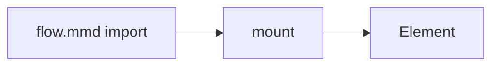

import { Card, Cards, Tab, Tabs } from 'vocs'

# Mounting

Insert compiled diagrams into a page with the 210-byte `ondine` runtime.

## Overview

`mount` from `ondine` places precompiled SVG inside an element, replacing what the element held. It imports nothing from the compiler, so a page that mounts diagrams downloads no parser or layout code.

```ts title="main.ts"
import { mount } from 'ondine'
import flow from './flow.mmd'

// Replaces the element's contents with the diagram
const mounted = mount(document.getElementById('flow')!, flow)
```

`mount` accepts an SVG string or any object with an `svg` field, such as a [Vite import](/guides/vite) or a [`render`](/api/compiler/render) result.

## Mount a Diagram

The mounted SVG scales to its container's width by default and keeps its aspect ratio.



## Unmount a Diagram

The returned object's `unmount` empties the element. Mounting into the same element again replaces the previous diagram.

```ts title="main.ts"
// Removes the diagram from its element
mounted.unmount()
```

## Use a Framework

Frameworks that render markup can insert the SVG directly, without `mount`.

<Tabs>
<Tab title="React">

```tsx title="Flow.tsx"
import flow from './flow.mmd'

export function Flow() {
  // Compiled output is inert SVG, so it is inserted as markup
  return <div dangerouslySetInnerHTML={{ __html: flow.svg }} />
}
```

</Tab>
<Tab title="Vue">

```vue title="Flow.vue"
<script setup lang="ts">
import flow from './flow.mmd'
</script>

<template>
  <!-- Compiled output is inert SVG, so it is inserted as markup -->
  <div v-html="flow.svg" />
</template>
```

</Tab>
<Tab title="Svelte">

```svelte title="Flow.svelte"
<script lang="ts">
  import flow from './flow.mmd'
</script>

<!-- Compiled output is inert SVG, so it is inserted as markup -->
<div>{@html flow.svg}</div>
```

</Tab>
</Tabs>

## More

<Cards>
  <Card
    title="mount"
    icon="code"
    to="/api/ondine/mount"
    description="Reference for mount and its result."
  />
  <Card
    title="Theming"
    icon="palette"
    to="/guides/theming"
    description="Style mounted diagrams with CSS custom properties."
  />
  <Card
    title="Vite"
    icon="zap"
    to="/guides/vite"
    description="Import Mermaid files as precompiled SVG."
  />
</Cards>
