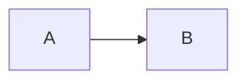

import { Card, Cards } from 'vocs'

# Node Compiler

Render Mermaid to SVG from build scripts, servers, and static site generators.

## Overview

`render` from `ondine/compiler` takes Mermaid source and returns the SVG document with its size and detected type. It loads the speed-optimized compiler module on the first call and reuses it afterward.

```ts title="build.ts"
import { render } from 'ondine/compiler'

// Compiles synchronously, with no browser or DOM
const { height, svg, type, width } = render('flowchart LR\n  A --> B')
```



## Walkthrough

The steps below render a Markdown site's diagrams during its build.

### Render Source

Pass the text of a ` ```mermaid ` block or a `.mmd` file.

```ts title="build.ts"
import * as Fs from 'node:fs'
import { render } from 'ondine/compiler'

// Writes the compiled SVG beside its source
const source = Fs.readFileSync('flow.mmd', 'utf8')
Fs.writeFileSync('flow.svg', render(source).svg)
```

### Handle Errors

Invalid source throws a `RenderError` with a code, a one-based line and column, and a snippet with a caret under the column.

```ts title="build.ts"
import { render, RenderError } from 'ondine/compiler'

try {
  render('flowchart LR\n  A -->')
} catch (error) {
  // Rethrows anything that is not a diagram error
  if (!(error instanceof RenderError)) throw error
  console.error(`flow.mmd:${error.line}:${error.column}: ${error.message}`)
}
```

### Insert the SVG

Compiled output is inert, so templates can insert it as raw HTML. Several diagrams can share a page.

```ts title="build.ts"
import { render } from 'ondine/compiler'

// Wraps the diagram in a figure for an HTML template
const html = `<figure>${render('pie\n  "A" : 1\n  "B" : 2').svg}</figure>`
```

## Recipes

### Fit a Column

`maxWidth` sets the available width. When a diagram running across does not fit, `autoDirection` draws it running down.

```ts
import { render } from 'ondine/compiler'

// Turns a long left-to-right chain into a top-to-bottom one
render('flowchart LR\n  A --> B --> C --> D --> E --> F', { maxWidth: 320 })
```

### Collect Links

`click` directives with URLs come back in `links`, in drawing order, for tools that check or rewrite them.

```ts
import { render } from 'ondine/compiler'

// [{ href: 'https://example.com/', id: 'A', internal: false }]
const { links } = render('flowchart LR\n  A --> B\n  click A "https://example.com"')
```

### Bound the Work

Untrusted source can be limited by length, edges, and output size. Each limit throws a `RenderError` with code `limit`.

```ts
import { render } from 'ondine/compiler'

export function handle(source: string) {
  // Rejects source over 10,000 characters and SVG over 1,000,000 characters
  return render(source, { limit: 10_000, outputLimit: 1_000_000 }).svg
}
```

### Create a Renderer

`create` builds a renderer over specific compiler modules, as [In-Browser Compilation](/guides/browser) describes. Node code rarely needs it.

## More

<Cards>
  <Card
    title="render"
    icon="code"
    to="/api/compiler/render"
    description="Every option and returned field."
  />
  <Card
    title="RenderError"
    icon="triangle-alert"
    to="/api/compiler/RenderError"
    description="Error codes, positions, and messages."
  />
  <Card
    title="CLI"
    icon="terminal"
    to="/guides/cli"
    description="Render files without writing a script."
  />
</Cards>
