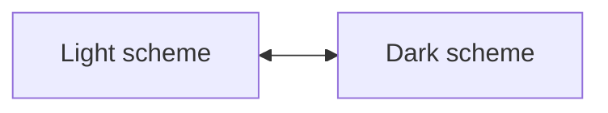
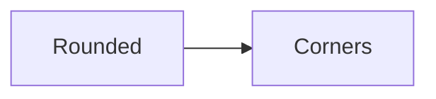
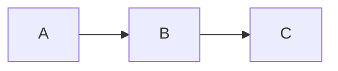
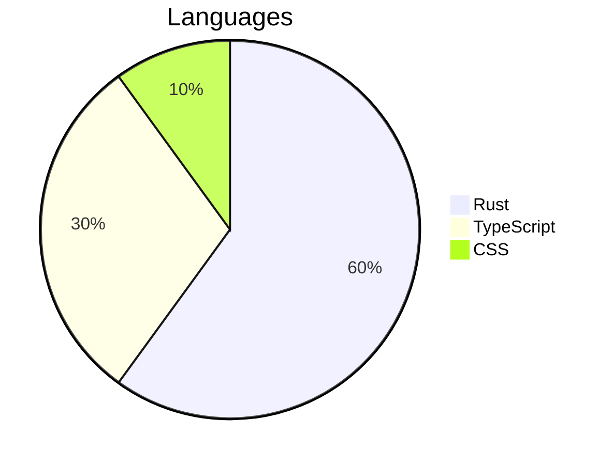
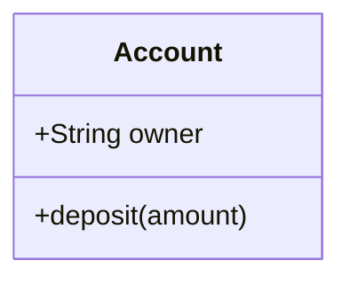

import { Card, Cards } from 'vocs'
import { Themed } from '../../components/Themed.js'

# Theming

Set a diagram's colors, font, corners, and strokes with CSS custom properties, without compiling again.

## Overview

Every compiled diagram reads its appearance from `--melee-*` custom properties on the root `<svg>` or any ancestor. Unset properties fall back to monochrome defaults: a white background, black foreground, square corners, and a monospace font.

Two properties theme a whole diagram. Node fills follow `--melee-bg`, while lines, borders, and text follow `--melee-fg`.

```css title="styles.css"
/* Draws every diagram on the page in light text on black */
.melee {
  --melee-bg: #000;
  --melee-fg: #fff;
}
```

Each SVG carries the classes `melee` and `melee-<type>`, such as `melee-flowchart`, so a rule can target one diagram type.

## Walkthrough

The steps below set a page's diagrams to follow the color scheme and the page's font.

### Follow the Scheme

`light-dark()` picks a value for the element's `color-scheme`, so one declaration covers both schemes.

```css title="styles.css"
/* Swaps background and foreground with the color scheme */
:root {
  color-scheme: light dark;
}

.melee {
  --melee-bg: light-dark(#fff, #000);
  --melee-fg: light-dark(#000, #fff);
}
```

This site sets the same two properties, so every diagram on it follows the theme switch.



### Match the Page

Set `--melee-bg` to the surface the diagram sits on, so node fills blend with the page.

```css title="styles.css"
/* Uses the page's surface color for node fills */
.melee {
  --melee-bg: var(--surface);
}
```

### Set the Font

`--melee-font` replaces the font stack. Melee measures every character at 0.6 em, so a monospace font keeps labels inside their shapes.

```css title="styles.css"
/* Draws labels in the page's monospace font */
.melee {
  --melee-font: 'Geist Mono', ui-monospace, monospace;
}
```

## Recipes

### Round Corners

`--melee-radius` rounds rectangles, which are square by default.

```css title="styles.css"
/* Rounds node corners */
.melee {
  --melee-radius: 6px;
}
```

<Themed theme="rounded">



</Themed>

### Change Stroke Width

`--melee-stroke` sets the width of shape outlines and edges. It defaults to `2px`.

```css title="styles.css"
/* Draws heavier outlines and edges */
.melee {
  --melee-stroke: 3px;
}
```

<Themed theme="stroke">



</Themed>

### Color Chart Series

Charts draw series with `--melee-series-1` through `--melee-series-8`. Each defaults to a shade between half and all of the foreground, so series stay visible on the background.

```css title="styles.css"
/* Colors the first three series */
.melee {
  --melee-series-1: #2563eb;
  --melee-series-2: #16a34a;
  --melee-series-3: #d97706;
}
```

<Themed theme="series">



</Themed>

### Lighten Bold Text

Titles, headings, and bold labels read their weights from `--melee-title-weight`, `--melee-heading-weight`, and `--melee-bold-weight`.

```css title="styles.css"
/* Draws titles and bold labels at normal weight */
.melee {
  --melee-bold-weight: normal;
  --melee-title-weight: normal;
}
```

<Themed theme="weights">



</Themed>

### Pin a Scheme

Diagrams served as images cannot read page styles. The [image Worker](/guides/github) embeds the properties itself and accepts `?scheme=light` or `?scheme=dark`.

## Properties

| Property                                 | Default                                                                                           | Applies to                                  |
| ---------------------------------------- | ------------------------------------------------------------------------------------------------- | ------------------------------------------- |
| `--melee-bg`                             | `#fff`                                                                                            | Background, and the default for fills       |
| `--melee-fg`                             | `#000`                                                                                            | Text, and the default for lines and borders |
| `--melee-line`                           | `--melee-fg`                                                                                      | Edges and connectors                        |
| `--melee-border`                         | `--melee-fg`                                                                                      | Shape outlines                              |
| `--melee-muted`                          | `--melee-fg`                                                                                      | Secondary text                              |
| `--melee-surface`                        | `--melee-bg`                                                                                      | Node fills                                  |
| `--melee-surface-alt`                    | 20% `--melee-fg`                                                                                  | Cluster fills, grids, and finished work     |
| `--melee-accent`                         | `--melee-fg`                                                                                      | Highlighted elements                        |
| `--melee-critical`                       | `--melee-fg`                                                                                      | Elements a diagram marks as critical        |
| `--melee-series-1` to `--melee-series-8` | Foreground shades                                                                                 | Chart series                                |
| `--melee-font`                           | `ui-monospace, SFMono-Regular, Menlo, Consolas, 'Liberation Mono', 'DejaVu Sans Mono', monospace` | Label font stack                            |
| `--melee-stroke`                         | `2px`                                                                                             | Outline and edge width                      |
| `--melee-radius`                         | `0`                                                                                               | Rectangle corner radius                     |
| `--melee-title-weight`                   | `bold`                                                                                            | Diagram titles                              |
| `--melee-heading-weight`                 | `bold`                                                                                            | Section and group headings                  |
| `--melee-bold-weight`                    | `bold`                                                                                            | Bold labels                                 |

## More

<Cards>
  <Card
    title="Mounting"
    icon="layout"
    to="/guides/mounting"
    description="Insert compiled diagrams into the page."
  />
  <Card
    title="GitHub Images"
    icon="image"
    to="/guides/github"
    description="Embed diagrams in READMEs with light and dark variants."
  />
  <Card
    title="Concepts & Principles"
    icon="book-open"
    to="/introduction/concepts"
    description="See how measurement and theme variables fit together."
  />
</Cards>
