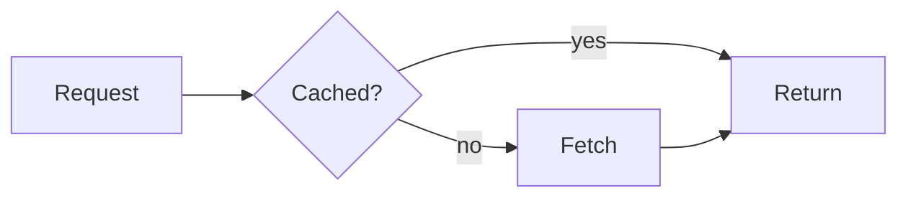

import { Card, Cards, Tab, Tabs } from 'vocs'

# Vite

Import `.mmd` and `.mermaid` files as SVG compiled during the Vite build.

## Overview

The `ondine` plugin from `ondine/vite` compiles each imported Mermaid file when Vite transforms it. The module's default export is the rendered diagram, so the page bundle holds SVG markup and no compiler.

```ts title="main.ts"
import flow from './flow.mmd'

// { height, svg, type, width }, computed at build time
console.log(flow.type)
```

A syntax error fails the transform with the file, line, and column, so Vite reports it in the terminal and the error overlay.

## Walkthrough

The steps below add the plugin, write a diagram, and show it on a page.

### Add the Plugin

```ts title="vite.config.ts"
import { defineConfig } from 'vite'
import { ondine } from 'ondine/vite'

export default defineConfig({
  // Compiles .mmd and .mermaid imports to SVG
  plugins: [ondine()],
})
```

### Write a Diagram

Save Mermaid source in a `.mmd` or `.mermaid` file.



### Show the Diagram

Mount the import into an element, or pass its `svg` to a framework.

<Tabs>
<Tab title="DOM">

```ts title="main.ts"
import { mount } from 'ondine'
import flow from './flow.mmd'

// Replaces the element's contents with the SVG
mount(document.getElementById('flow')!, flow)
```

</Tab>
<Tab title="React">

```tsx title="Flow.tsx"
import flow from './flow.mmd'

export function Flow() {
  // Compiled output is inert SVG, so it is inserted as markup
  return <div dangerouslySetInnerHTML={{ __html: flow.svg }} />
}
```

</Tab>
</Tabs>

## Recipes

### Type the Imports

`ondine/vite/client` declares the default export of `.mmd` and `.mermaid` imports. Reference it from a declaration file, or list it in `compilerOptions.types`.

```ts title="src/env.d.ts"
// Types the default export of every Mermaid import
/// <reference types="ondine/vite/client" />
```

### Compile Markdown

`ondine/remark` compiles ` ```mermaid ` fences in `.md` and `.mdx` files. Add it to the MDX plugin, which handles both formats.

```ts title="vite.config.ts"
import mdx from '@mdx-js/rollup'
import { defineConfig } from 'vite'
import { remarkOndine } from 'ondine/remark'

export default defineConfig({
  // Replaces each Mermaid fence with inline SVG during the build
  plugins: [mdx({ remarkPlugins: [remarkOndine] })],
})
```

Each fence becomes `<div class="ondine-diagram">` around the SVG, as elements rather than a markup string, so it renders in any framework MDX targets. A syntax error fails the build with the Markdown file, line, and column.

### Fit a Column

`maxWidth` tells the compiler how wide the diagram may be. A diagram that runs across and does not fit is drawn running down instead.

```ts title="vite.config.ts"
import { defineConfig } from 'vite'
import { ondine } from 'ondine/vite'

export default defineConfig({
  // Lays out every diagram for a 640-pixel column
  plugins: [ondine({ maxWidth: 640 })],
})
```

The plugin accepts every [`render` option](/api/compiler/render#parameters) except `idPrefix`, which it derives from each file's path.

### Pin the Schedule

Gantt charts schedule relative tasks against the current time. Set `now` for reproducible builds.

```ts title="vite.config.ts"
import { defineConfig } from 'vite'
import { ondine } from 'ondine/vite'

export default defineConfig({
  // Schedules every gantt chart against January 15, 2024
  plugins: [ondine({ now: Date.UTC(2024, 0, 15) })],
})
```

## More

<Cards>
  <Card
    title="Mounting"
    icon="layout"
    to="/guides/mounting"
    description="Insert compiled diagrams into the page."
  />
  <Card
    title="Theming"
    icon="palette"
    to="/guides/theming"
    description="Set colors, fonts, and strokes with CSS custom properties."
  />
  <Card
    title="ondine/vite"
    icon="file-code"
    to="/api/vite/ondine"
    description="Reference for the plugin and its options."
  />
  <Card
    title="ondine/remark"
    icon="file-code"
    to="/api/remark/remarkOndine"
    description="Compile Mermaid fences in Markdown and MDX."
  />
</Cards>
