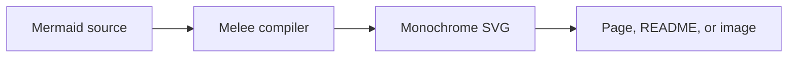

import { Card, Cards } from 'vocs'

# Melee

Monochrome Mermaid diagrams, compiled with Rust.

Melee compiles Mermaid source to monochrome, monospace SVG ahead of time. Pages ship the SVG and a 210-byte runtime, and every diagram on this site was rendered by Melee when the site was built.

<Cards>
  <Card
    title="Getting Started"
    icon="rocket"
    to="/introduction/getting-started"
    description="Install Melee and compile a first diagram."
  />
  <Card
    title="Why Melee"
    icon="lightbulb"
    to="/introduction/why-melee"
    description="What compiling diagrams ahead of time changes."
  />
  <Card
    title="Diagrams"
    icon="shapes"
    to="/diagrams/flowchart"
    description="Every diagram type with rendered examples."
  />
  <Card title="API" icon="code" to="/api/compiler" description="Reference for each entrypoint." />
</Cards>
