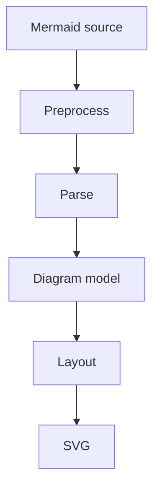
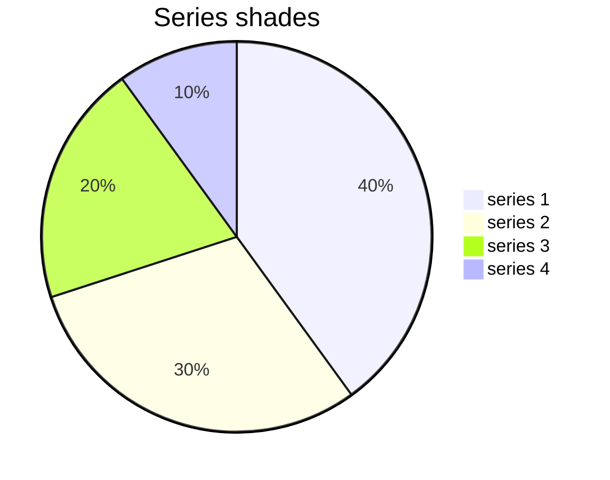

import { Card, Cards } from 'vocs'

# Concepts & Principles

The model behind Ondine: where diagrams compile, how they are measured, and what the output guarantees.

## Overview

Ondine splits into a compiler and a runtime. The compiler is Rust built to WebAssembly, and turns Mermaid source into an SVG document. The runtime inserts that document into a page.

## Compile Targets

The compiler ships as WebAssembly in two profiles. Node, the CLI, and the image Worker load one module optimized for speed. Browsers load a module optimized for size from `ondine/compiler/wasm/all`.

| Entrypoint             | Runs in           | Module                    |
| ---------------------- | ----------------- | ------------------------- |
| `ondine/compiler`      | Node              | Every type, speed profile |
| `ondine/vite`          | Vite builds       | Every type, speed profile |
| `ondine/remark`        | Markdown builds   | Every type, speed profile |
| `ondine` CLI           | Node              | Every type, speed profile |
| `ondine/compiler/wasm` | Browsers, Workers | Supplied by the caller    |
| `ondine`               | Browsers          | None                      |

Browsers that compile only some types load one size-optimized module per type from `ondine/compiler/wasm/<type>`. Each module also ships as a raw `.wasm` file for hosts that compile WebAssembly ahead of time.

## Text Measurement

Labels are measured with a uniform monospace advance of 0.6 em per character. Wide characters take 1.2 em and zero-width characters take none.

Measurement needs no canvas, font tables, or DOM. A diagram compiled in Node is byte-identical to the same diagram compiled in a browser.

## Theme Variables

The SVG reads its colors, font, corner radius, and stroke width from `--ondine-*` custom properties, with monochrome defaults. Setting `--ondine-bg` and `--ondine-fg` themes a whole diagram. [Theming](/guides/theming) lists every property.

Chart series default to shades between the foreground and background, so charts stay monochrome in both schemes.

## Inert Output

Output follows Mermaid's strict security level. Every authored string is escaped, and the SVG holds no scripts, event handlers, or external references.

Inserting compiled SVG with `innerHTML` is therefore safe, which is all [`mount`](/api/ondine/mount) does.

## More

<Cards>
  <Card
    title="Node Compiler"
    icon="terminal"
    to="/guides/node"
    description="Render diagrams from scripts and servers."
  />
  <Card
    title="In-Browser Compilation"
    icon="globe"
    to="/guides/browser"
    description="Compile in the browser with WebAssembly modules."
  />
  <Card
    title="Theming"
    icon="palette"
    to="/guides/theming"
    description="Set colors, fonts, and strokes with CSS custom properties."
  />
  <Card
    title="Compatibility"
    icon="list-checks"
    to="/introduction/compatibility"
    description="See which diagram types render today."
  />
</Cards>
