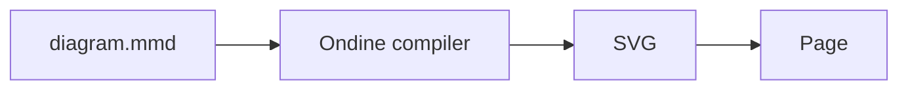

import { Card, Cards, Tab, Tabs } from 'vocs'

# Getting Started

Compile Mermaid diagrams to SVG ahead of time and mount them with a 210-byte runtime.

## Overview

Ondine renders Mermaid source to monochrome, monospace SVG. A Rust compiler parses, lays out, and draws each diagram at build time, so pages ship SVG markup instead of a diagram renderer.



The compiler runs through the Vite plugin, the `ondine` CLI, the Node API, an image Worker for Markdown hosts, and, when a page must compile at runtime, a WebAssembly module in the browser.

## Install

Install Ondine with the project's package manager.

> [!NOTE]
> Ondine is not published to npm yet. The commands below apply once the first release ships.

:::code-group

```sh [pnpm]
# Adds Ondine to the project
pnpm add ondine
```

```sh [npm]
# Adds Ondine to the project
npm install ondine
```

```sh [yarn]
# Adds Ondine to the project
yarn add ondine
```

:::

## Setup

Choose the integration that matches the build. Each one runs the same compiler and produces the same bytes.

<Tabs>
<Tab title="Vite">

Add the plugin to `vite.config.ts`. Imports of `.mmd` and `.mermaid` files then compile at build time.

```ts title="vite.config.ts"
import { defineConfig } from 'vite'
import { ondine } from 'ondine/vite'

export default defineConfig({
  // Compiles .mmd and .mermaid imports to SVG
  plugins: [ondine()],
})
```

Import a diagram and mount it. The default export holds the SVG, its size, and the detected type.

```ts title="main.ts"
import { mount } from 'ondine'
import flow from './flow.mmd'

// Inserts the precompiled SVG into the element
mount(document.getElementById('flow')!, flow)
```

</Tab>
<Tab title="CLI">

Render Mermaid files to SVG files beside them, or into a separate directory.

```sh
# Writes flow.svg next to flow.mmd
npx ondine flow.mmd

# Writes every diagram into public/diagrams
npx ondine diagrams/*.mmd --out-dir public/diagrams
```

With no files, the CLI reads standard input and writes SVG to standard output.

```sh
# Pipes Mermaid in and SVG out
echo 'flowchart LR; A --> B' | npx ondine > flow.svg
```

</Tab>
<Tab title="Node">

Call `render` from a build script, a server, or a static site generator.

```ts title="build.ts"
import { render } from 'ondine/compiler'

// Returns the SVG document with its size and diagram type
const { svg } = render('flowchart LR\n  A --> B')
```

The compiler module loads on the first call, and later calls reuse it.

</Tab>
</Tabs>

## Next Steps

<Cards>
  <Card
    title="Vite"
    icon="zap"
    to="/guides/vite"
    description="Import Mermaid files as precompiled SVG."
  />
  <Card
    title="Theming"
    icon="palette"
    to="/guides/theming"
    description="Set colors, fonts, and strokes with CSS custom properties."
  />
  <Card
    title="Diagrams"
    icon="shapes"
    to="/diagrams/flowchart"
    description="Browse every diagram type with rendered examples."
  />
  <Card
    title="Compatibility"
    icon="list-checks"
    to="/introduction/compatibility"
    description="See which Mermaid diagram types render today."
  />
</Cards>
