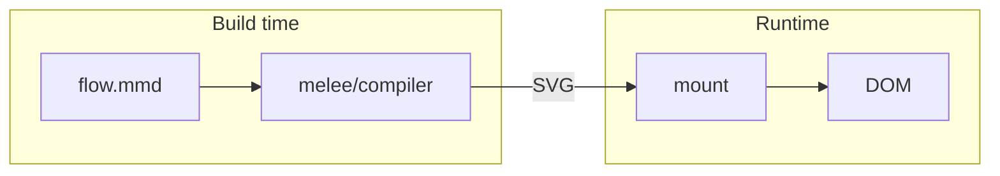
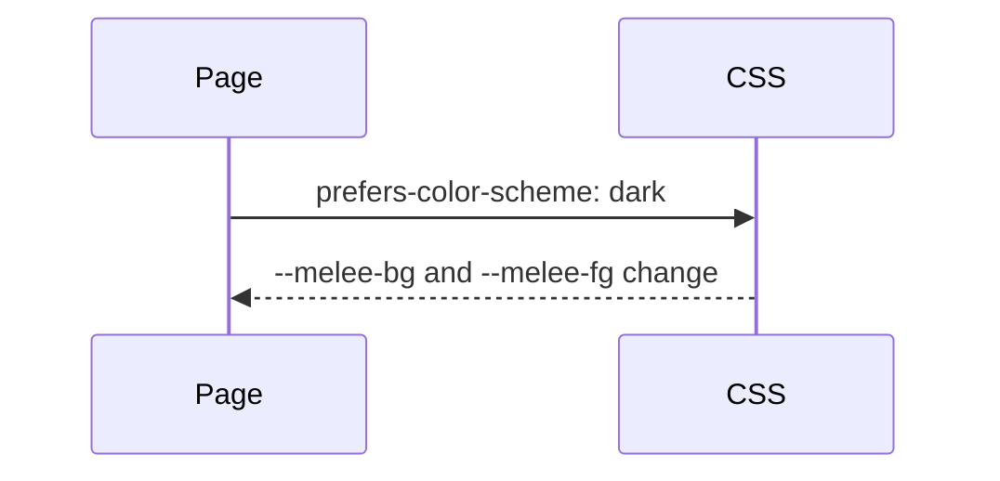

import { Card, Cards } from 'vocs'

# Why Melee

Mermaid source, compiled once into SVG that pages display without a renderer.

## Overview

A Mermaid diagram usually renders in the browser: the page downloads a parser and layout engine, measures text with the DOM, and draws after the page loads. Melee moves all of that to build time.

The page then receives finished SVG. Mounting it inserts markup, which the `melee` runtime does in 210 bytes gzip.

## Compiled Ahead of Time

Diagrams compile in the Vite plugin, the CLI, a Node script, or the image Worker. A syntax error fails the build with its line and column, so a broken diagram never reaches a page.

The compiler reads no files, clock, or environment. The same source and options produce the same bytes in Node, browsers, and Workers.

## Monochrome and Monospace

Every diagram uses one foreground and one background color, square outlines, rounded orthogonal edges, and a monospace font. Text widths come from a fixed advance per character, so layout does not depend on installed fonts.

Colors, fonts, and stroke widths are CSS custom properties. A page switches between light and dark schemes without compiling again.

## Mermaid Syntax

Melee targets the complete syntax of Mermaid 12.1.0. Each diagram type accepts and rejects the same input as Mermaid and builds the same model. Layout and appearance differ by design.

[Compatibility](/introduction/compatibility) lists every diagram type and its status.

## More

<Cards>
  <Card
    title="Getting Started"
    icon="rocket"
    to="/introduction/getting-started"
    description="Install Melee and compile a first diagram."
  />
  <Card
    title="Concepts & Principles"
    icon="book-open"
    to="/introduction/concepts"
    description="See how compilation, measurement, and theming fit together."
  />
  <Card
    title="Benchmarks"
    icon="gauge"
    to="/introduction/benchmarks"
    description="Review measured module sizes and render times."
  />
  <Card
    title="Theming"
    icon="palette"
    to="/guides/theming"
    description="Set colors, fonts, and strokes with CSS custom properties."
  />
</Cards>
